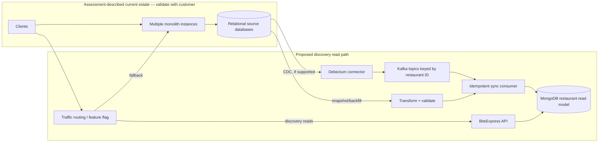

# BiteExpress migration strategy

This is a **proposed customer migration plan**, not a description of deployed BiteExpress infrastructure. The assessment describes an on-premise, multi-instance monolith backed by relational databases. Its database engine, schema, traffic, contracts, recovery objectives, and regulatory obligations need customer confirmation. The implemented MVP is a Java 21 / Spring Boot 4.1.2 service with one MongoDB `restaurants` collection, CSV import, four HTTP endpoints, and structured, geospatial, and rule-based language search. It has **no CDC, Kafka, legacy integration, production replication, or automatic fallback**.

## Target boundary and sequence

Restaurant discovery is a useful first read workload: a restaurant is naturally retrieved with its address, country, cuisines, pricing, rating, features, and optional GeoJSON location. The relational database remains the **authoritative write source** during the first migration steps. MongoDB is a derived read model; search results may temporarily lag committed source changes. Do not dual-write from the monolith and hope both writes succeed atomically.

The boxes labeled proposed are not in this repository. The current MVP uses CSV import rather than the source-database path shown above.

| Step | Action | Exit evidence |
| --- | --- | --- |
| 0. Baseline | Inventory source tables, keys, joins, change rate, traffic, latency, data ownership, and failure modes. Agree on data contracts and success thresholds. | Signed-off field mapping, latency/lag targets, and rollback owner. |
| 1. Backfill | Take a source-consistent snapshot or recorded high-water mark; stream and transform records in bounded batches into a separate MongoDB read-model environment. Preserve source IDs in stable document IDs. | Counts, checksums or sampled field comparisons, rejects, and transformation version recorded. |
| 2. Change stream | Where the relational engine and deployment permit it, use Debezium with a supported connector and log-based CDC. Publish to Kafka; consume into MongoDB with idempotent, version-aware upserts. | Connector health, durable offsets, lag, replay, delete, and recovery tests. |
| 3. Shadow reads | Route production reads to the legacy result while invoking the new read path asynchronously for comparison. Normalize known semantic differences before diffing. | Match-rate and latency trends by query class, including missing coordinates and ratings. |
| 4. Cutover | Start with opt-in/canary discovery traffic, then increase the fraction only while error, latency, freshness, and result-quality thresholds hold. Keep legacy route available. | Recorded canary decisions, monitoring dashboards, tested rollback. |
| 5. Expand | Consider other read domains and service boundaries only after discovery proves value; move write authority only through a separately designed migration. | Explicit ownership and consistency contracts for each domain. |

## Backfill and continuous synchronization

Define a canonical restaurant key in the relational source. The current CSV importer derives deterministic UUIDs from source restaurant IDs; a production sync should use the same stable-key principle but **not assume** the CSV namespace is the future relational key. Document any identity crosswalk before loading records. Transform related rows into the single restaurant document: embedded address/country/pricing/rating/features, cuisine array, and GeoJSON `[longitude, latitude]` only for valid coordinates. Keep source values where meaningful; record missing or rejected fields and transformation version. Do not invent country names or ratings.

Backfill should capture a consistent snapshot together with the CDC starting position. Buffer or replay changes after that position, then apply only events newer than the version already stored. A source transaction involving several tables can emit several events; use a composition stage or transactional outbox if complete restaurant snapshots cannot be reconstructed safely. The exact mechanism depends on the relational engine and Debezium connector support. The customer must validate log retention, connector permissions, table primary keys, DDL behavior, and Kafka availability before choosing CDC.

Partition Kafka by restaurant ID to preserve per-restaurant order within a topic. Store source commit position or monotonically comparable version with each MongoDB document. An upsert must be conditional on that version so retries, snapshot overlap, and old events cannot overwrite newer state. For deletes, emit a durable tombstone or a `deleted` state with version, apply it conditionally, and retain the marker long enough to prevent a late older upsert from resurrecting the restaurant. Define how child-row deletes update embedded arrays. Cross-restaurant ordering and instantaneous read-after-write consistency are **not guaranteed** by this asynchronous design.

Use bounded retries with backoff for transient MongoDB/Kafka failures; park persistent validation failures in a dead-letter workflow with source key, event version, reason, and replay procedure. Commit Kafka offsets only after the MongoDB write succeeds. On restart, replay is expected and safe because writes are idempotent. Monitor source-to-Kafka and Kafka-to-MongoDB lag separately, plus rejected events, retries, tombstones, and consumer pauses.

Reconcile independently of CDC: compare source and read-model counts by segment and update window, sample stable keys and field hashes, verify deletes and coordinates, and repair mismatches by replaying or rebuilding affected keys. During backfill, use shadow reads only; do not expose partially loaded results. A count match alone is insufficient evidence of correctness.

## Traffic, consistency, and rollback

Keep legacy writes and transaction semantics unchanged during the discovery rollout. State the contract to clients as eventually consistent search, with an agreed freshness target and a documented path for operations requiring authoritative data. Shadow comparisons should include empty results, pagination order, currency, country resolution, and invalid or absent geolocation. Compare equivalently normalized responses; some ranking differences may be intentional and need product sign-off.

Use a routing flag at the ingress or monolith boundary. A canary can move a small portion of discovery reads to BiteExpress while maintaining the legacy path. Roll back the flag if error rate, p95/p99 latency, CDC lag, reconciliation mismatches, index health, or MongoDB availability breach agreed thresholds. Test rollback before cutover. If MongoDB is unavailable, serve discovery through the legacy route where its query contract supports it; otherwise fail explicitly rather than silently returning stale or incompatible results. Do not disable CDC automatically on read rollback: keeping the read model current makes recovery easier. If the source or CDC pipeline fails, hold or revert traffic according to the freshness objective.

The current MVP has no traffic router, CDC consumer, or fallback implementation. Its local 10-second k6 results and `explain` plans in [the performance report](../performance.md) demonstrate only the present dataset and environment; they do not establish production SLOs or a before/after migration benefit.

## Operations and time horizons

**Next 6–12 months, proposed:** define SLOs and recovery objectives; instrument request latency, error rate, query plans, replica health, CDC lag, and reconciliation; test backup restoration and failover; secure network access and secrets; profile count/sort/deep-page costs on representative data before adding indexes. Run longer workloads with realistic concurrency and write churn. The MVP's observed `location_2dsphere` index supports `$geoNear`; ordinary case-insensitive regex queries scanned the 9,554-document benchmark collection, so index changes need isolated measurements.

**Next 2–3 years, proposed:** evaluate a managed Atlas deployment or self-managed replica set, multi-zone availability, tested backups and point-in-time recovery, capacity planning, stateless API scaling, and dedicated search only if product needs exceed structured and rule-based queries. Consider regional placement, data residency, retention/deletion policies, encryption in transit and at rest, least-privilege roles, audit logs, and disaster-recovery drills. Internationalization must address currencies, transliteration, locale-aware matching, time zones, and address formats; the current dataset's country/currency anomalies should remain visible until business rules are agreed.

## Decisions, risks, and customer questions

| Choice | Benefit | Risk or alternative |
| --- | --- | --- |
| MongoDB as a derived discovery model | Restaurant reads fit one document; GeoJSON and `2dsphere` support nearby search. | Duplicate source fields and eventual consistency require synchronization and reconciliation. Keep relational writes authoritative initially. |
| CDC plus Kafka | Durable replay and decoupled consumers when the source permits log capture. | More operations and lag; use scheduled incremental export if CDC is unsupported or unjustified, with weaker freshness. |
| Idempotent versioned upserts | Safe retries and snapshot/CDC overlap. | Requires trustworthy source identity and order/version metadata. |
| Gradual routing | Limits blast radius and allows measured comparison. | Parallel paths add temporary cost and semantic-diff work. |

Validate before execution: actual relational engine and CDC compatibility; table relationships and deletion semantics; source ID stability; peak reads/writes; acceptable search freshness; latency and availability targets; security and residency obligations; existing backup and failover processes; and which legacy queries can serve as fallback. This plan does not authorize data movement or define a production deployment on its own.
